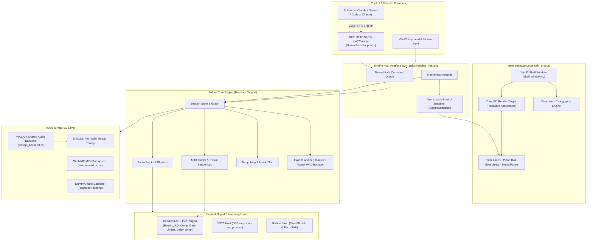

# Airdour

> **A lightweight, Windows-native Digital Audio Workstation (DAW)** powered by the Ardour 9 audio engine, a hardware-accelerated **Win32 + Direct2D / DirectWrite** shell, a native **WASAPI shared-mode** audio backend with **WinMME MIDI**, and a built-in **Model Context Protocol (MCP) HTTP surface** for AI assistant integration.

[](https://github.com/bezko/airdour/actions/workflows/windows-msvc.yml)
[](file:///c:/Users/mathieu/Documents/GitHub/airdour/COPYING)
[](file:///c:/Users/mathieu/Documents/GitHub/airdour/cmake/win64/CMakeLists.txt)
[](file:///c:/Users/mathieu/Documents/GitHub/airdour/libs/backends/wasapi/README.md)
[](file:///c:/Users/mathieu/Documents/GitHub/airdour/win_ardour/README.md)

---

## Table of Contents

1. [Architecture & System Overview](#architecture--system-overview)
2. [Core Innovations & Technical Differentiators](#core-innovations--technical-differentiators)
3. [Subsystems](#subsystems)
   - [Direct2D Native GUI Shell (`win_ardour`)](#1-direct2d-native-gui-shell-win_ardour)
   - [WASAPI Shared-Mode Backend (`libs/backends/wasapi`)](#2-wasapi-shared-mode-backend-libsbackendswasapi)
   - [Headless Engine Core (`hardour` / `libardour`)](#3-headless-engine-core-hardour--libardour)
   - [Model Context Protocol (MCP) HTTP Surface](#4-model-context-protocol-mcp-http-surface)
   - [DSP Engine & Audio Effects (ACE LV2 & VST3)](#5-dsp-engine--audio-effects-ace-lv2--vst3)
   - [Editing, Time-Stretching & Pitch-Shifting](#6-editing-time-stretching--pitch-shifting)
   - [Real-time Analysis & Metering](#7-real-time-analysis--metering)
4. [Keyboard Shortcuts Reference](#keyboard-shortcuts-reference)
5. [CLI Flags & Smoke Test Harness](#cli-flags--smoke-test-harness)
6. [Building from Source](#building-from-source)
   - [Prerequisites](#prerequisites)
   - [Dependency Setup via vcpkg](#dependency-setup-via-vcpkg)
   - [UI-Only Build (CMake)](#ui-only-build-cmake)
   - [Full Engine Release Build (Waf + CMake)](#full-engine-release-build-waf--cmake)
   - [Debug Engine Build](#debug-engine-build)
7. [Packaging & CI/CD Pipeline](#packaging--cicd-pipeline)
8. [Technical Constraints & Design Decisions](#technical-constraints--design-decisions)
9. [Repository Layout](#repository-layout)
10. [License & Acknowledgments](#license--acknowledgments)

---

## Architecture & System Overview

Airdour decouples the mature, sample-accurate, 64-bit floating-point audio processing engine of Ardour from legacy POSIX/GTK dependencies on Windows. By replacing GTK2, X11 shims, and Cairo with native Windows API primitives (**Direct2D 1.0**, **DirectWrite**, **MMCSS Pro Audio**, and **WASAPI**), Airdour achieves immediate startup, minimal working set memory overhead, and smooth 60 FPS DPI-aware rendering.



### Threading Architecture

1. **UI Thread (Main STA)**: Executes the Win32 message loop (`wmain` in [main.cc](file:///c:/Users/mathieu/Documents/GitHub/airdour/win_ardour/main.cc)), handles keyboard/mouse interaction, and issues Direct2D drawing commands in [shell_window.cc](file:///c:/Users/mathieu/Documents/GitHub/airdour/win_ardour/shell_window.cc). **Never** executes blocking disk I/O or DSP code.
2. **Realtime Audio Thread**: Driven by WASAPI event-driven process buffers (`wait_for_period` in [wasapi_backend.cc](file:///c:/Users/mathieu/Documents/GitHub/airdour/libs/backends/wasapi/wasapi_backend.cc)). Boosted to Windows MMCSS `"Pro Audio"` category with `AVRT_PRIORITY_HIGH`. Responsible for audio sample deinterleaving, format conversion (float32/int16/int24/int32), buffer routing, and DSP plugin processing.
3. **MIDI Processing**: Real-time MIDI events are gathered asynchronously via Windows Multimedia Extensions (`winmm.dll`) and ingested into the audio cycle buffer with microsecond timestamps.
4. **Analysis & Background Workers**: Peak calculation for wave strips (`AudioRegion::read_peaks`), session autosave threads, and RubberBand offline stretches operate in background worker threads without interrupting audio stream continuity.

---

## Core Innovations & Technical Differentiators

| Feature | Upstream Ardour (Windows) | Airdour |
| :--- | :--- | :--- |
| **Windowing & GUI Toolkit** | GTK2 + X11 compatibility shims + Cairo | **Native Win32 + Direct2D + DirectWrite** |
| **Audio Backend** | PortAudio / ASIO third-party drivers required | **Native WASAPI Shared-Mode** (Zero driver install) |
| **MIDI Subsystem** | PortAudio MIDI Bridge / ALSA-layer emulation | **Native WinMME subsystem** ([winmmemidi_io.cc](file:///c:/Users/mathieu/Documents/GitHub/airdour/libs/backends/portaudio/winmmemidi_io.cc)) |
| **AI Integration** | None / Manual OSC / Lua scripts | **Native MCP HTTP Server** ([libs/surfaces/mcp_http](file:///c:/Users/mathieu/Documents/GitHub/airdour/libs/surfaces/mcp_http/README.md)) |
| **Startup Memory Footprint** | ~400 MB – 600 MB working set | **~116 MB** working set in Release engine |
| **DSP Overhead** | High due to POSIX translation layers | **~11% DSP load** baseline on standard mobile hardware |
| **Toolchain & Compiler** | MinGW / MSYS2 / GCC cross-compilation | **Visual Studio 2022 (MSVC / cl.exe) + CMake + Waf** |
| **Package Format** | Installer requiring extensive GTK runtime | **Self-contained portable ZIP** and an NSIS installer |

---

## Subsystems

### 1. Direct2D Native GUI Shell (`win_ardour`)

Located in [`win_ardour/`](file:///c:/Users/mathieu/Documents/GitHub/airdour/win_ardour/README.md), the user interface is completely written in C++17 utilizing Windows Direct2D and DirectWrite.

- **High-DPI Awareness**: Per-Monitor V2 DPI scaling (`GetDpiForWindow` / `ID2D1Factory`). Layout dimensions, fonts, and controls dynamically adjust across display migrations.
- **Stacked Track Editor**: Multi-lane audio timeline rendering region waveforms directly from mipmapped audio peak caches (`AudioRegion::read_peaks`).
- **Piano-Roll MIDI Editor**: Note sequencing lane (C3–B4) supporting click-drag note creation, length trimming, velocity dragging, multi-note selection, clipboard operations, and QWERTY step-entry.
- **Mixer Strips**: Vertical channel strips featuring level faders, pan azimuth knobs, aux send controls, peak-hold clip indicators, Mute, Solo, and Record-Arm toggles.
- **Transient Overlays**: Dismissible startup splash, interactive shortcuts reference overlay (`F1` / `?`), Preferences modal, Session History navigator, and Recent Sessions drawer.

### 2. WASAPI Shared-Mode Backend (`libs/backends/wasapi`)

Located in [`libs/backends/wasapi/`](file:///c:/Users/mathieu/Documents/GitHub/airdour/libs/backends/wasapi/README.md), implementing the full `ARDOUR::AudioBackend` interface.

- **Shared Mode Exclusivity**: Operates exclusively in Windows shared mode (`AUDCLNT_SHAREMODE_SHARED`). Users can mix DAW audio with YouTube, Spotify, and browser playback simultaneously without audio device lockouts.
- **Period Laddering & Rate Adaptation**: Dynamically negotiates formats using `IMMDeviceEnumerator` and `IAudioClient3::InitializeSharedAudioStream`. Snaps to hardware engine period fundamentals (e.g. 128, 240, 256, or 480 samples).
- **Float & Integer Conversion**: Optimized SIMD-compatible sample format translation routines for IEEE 32-bit float, 16-bit PCM, 24-bit PCM, and 32-bit PCM.
- **WinMME MIDI Driver**: Native Win32 MIDI input and output ports with millisecond-accurate timestamping, GS Wavetable routing, and loopback compatibility.

### 3. Headless Engine Core (`hardour` / `libardour`)

The Ardour DAW engine can run fully decoupled from any GUI:
- **`hardour` CLI**: Command-line headless test harness that executes automated session loading, audio routing, rendering benchmarks, and verification runs without spinning up a window.
- **`ExportHandler`**: Headless master bus WAV rendering engine supporting stem exports and full-mix bounces (`Ctrl+E` or `--smoke-export`).

### 4. Model Context Protocol (MCP) HTTP Surface

Located in [`libs/surfaces/mcp_http/`](file:///c:/Users/mathieu/Documents/GitHub/airdour/libs/surfaces/mcp_http/README.md). Airdour natively exposes an HTTP-based MCP server at `http://127.0.0.1:4820/mcp`, allowing Large Language Models (Claude, Gemini, OpenAI Codex, Ollama) to programmatically orchestrate the DAW:

- **Transport Control**: `transport/play`, `transport/stop`, `transport/locate`, `transport/loop_toggle`, `transport/set_record_enable`.
- **Track & Bus Management**: `tracks/list`, `tracks/add`, `buses/add`, `track/set_fader`, `track/set_pan`, `track/set_mute`, `track/set_solo`.
- **Plugin Orchestration**: `plugin/list_available`, `plugin/add`, `plugin/remove`, `plugin/set_parameter`, `plugin/set_enabled`.
- **Arrangement & Editing**: `markers/add`, `region/move`, `region/split`, `region/set_gain`, `region/normalize`.
- **Bulk MIDI JSON Generation**: `midi_note/import_json` and `midi_note/get_json` supporting bar-relative offsets, musical divisions, velocity layers, chords, and drum tracks.

### 5. DSP Engine & Audio Effects (ACE LV2 & VST3)

Airdour embeds native, headless LV2 audio processing plugins pre-wired into session tracks:

- **Audio 1 — ACE Reverb**: High-density stereo algorithmic reverb featuring direct wet/dry **Blend** control and bypass toggling from the mixer pane.
- **Audio 2 — ACE Compressor**: Studio compressor with adjustable threshold, compression ratio, attack, release, and sidechain input.
- **Audio 3 — ACE EQ**: 3-band parametric equalizer featuring Low, Mid, and High shelf/peak gain controls.
- **Audio 4 — ACE Delay**: Tempo-synchronized delay line with Feedback and Time sliders.
- **Audio 5 — ACE Limiter**: Brickwall peak limiter with ceiling control and fast lookahead release.
- **Audio 6 — ACE Gate**: Noise gate with configurable threshold and hold parameters.
- **MIDI 1 — ACE Reasonable Synth**: Built-in LV2 synthesizer that converts MIDI note sequences to audible audio out of the box with zero external sound fonts or plugins required.
- **VST3 Host Architecture**: Integrated VST3 plugin scanning (`VST3_SUPPORT`) for standard Windows system paths (`C:\Program Files\Common Files\VST3`) and custom `VST3_PATH` locations.

### 6. Editing, Time-Stretching & Pitch-Shifting

The editing engine provides instant non-destructive audio manipulation:
- **Non-destructive Region Editing**: Region trimming, body moving, splitting (`S`), fades and crossfades (`F`), region duplicate (`D`), and deletion (`Delete`).
- **RubberBand Integration**: Headless pitch-shifting (`R` / `Shift+R` semitones) and time-stretching (`T` / `Shift+T` 1.5× / 0.75×) via the integrated RubberBand library.
- **Clean-up & Mastering Operations**: Normalize to -1 dBFS (`N`), reverse playback (`V`), silence stripping at -40 dBFS threshold (`I`), track bounce-in-place (`B`), and track freezing (`Z`).

### 7. Real-time Analysis & Metering

Hardware-accelerated visual meters rendered via Direct2D:
- **Spectrum Analyzer (`Y`)**: Multi-band Goertzel filter bank analyzing spectral energy distributions in real time on the master bus.
- **Phase Correlation & Goniometer (`X`)**: Real-time Lissajous stereo phase goniometer and numerical correlation meter ([-1.0, +1.0]) for mono compatibility checking.
- **Loudness Meter (`J`)**: Integrated ITU-R BS.1770 K-weighted approximate LUFS meter.

---

## Keyboard Shortcuts Reference

Airdour provides a rapid, single-key workflow designed for efficiency. Press `F1` or `?` at any time to display the in-app interactive overlay.

| Category | Shortcut | Description |
| :--- | :--- | :--- |
| **Transport** | `Space` | Play / Stop transport |
| | `L` | Toggle transport loop range |
| | `P` | Toggle punch in/out range |
| | `[` / `]` | Set loop range start / end at current playhead |
| | `Shift+[` / `Shift+]` | Set punch range start / end at current playhead |
| | `C` | Toggle count-in before recording |
| | `K` | Toggle metronome click |
| | `+` / `-` | Increase / decrease tempo by 1 BPM |
| | `Home` / `0` | Reset editor view / return to playhead |
| **Arrangement & Editing** | `S` | Split selected region at playhead |
| | `F` | Apply fade / crossfade affordance to selection |
| | `Delete` | Remove selected audio/MIDI region or note |
| | `T` / `Shift+T` | RubberBand time-stretch: 1.5× slow / 0.75× speed-up |
| | `R` / `Shift+R` | RubberBand pitch-shift: +1 / -1 semitone (duration preserved) |
| | `V` | Reverse selected audio region |
| | `N` | Normalize selected audio region to -1 dBFS peak |
| | `I` | Strip silence from region (-40 dBFS threshold) |
| | `B` | Consolidate / bounce selection in place |
| | `Z` | Freeze / unfreeze focused audio track |
| | `G` / `Shift+G` | Toggle grid snap on/off / cycle snap density |
| | `M` / `Shift+M` | Add / remove timeline location marker |
| **MIDI & Piano-Roll** | `Q` | Quantize selected MIDI notes to snap grid |
| | `,` / `.` | Transpose MIDI notes: -1 / +1 semitone (`Shift` for ±12 semitones) |
| | `↑` / `↓` | Adjust note velocity: +1 / -1 (`Shift` for ±8 velocity) |
| | `Alt+←` / `Alt+→` | Trim note length: - / + snap unit (`Shift` for larger steps) |
| | `Ctrl+C` / `X` / `V` | Copy / Cut / Paste MIDI notes at playhead |
| | `H` / `Shift+H` | Apply MIDI humanize timing and velocity jitter |
| | `F4` | Toggle MIDI step-recording mode (QWERTY piano keys `Z`-`M` / `Q`-`U`) |
| | `F5` | Cycle MIDI chord mode (`Off` → `Major` → `Minor`) |
| | `F6` | Toggle MIDI arpeggiator (`Shift` cycles Up / Down / Up-Down) |
| | `F7` | Toggle MIDI scale lock (`Shift` cycles scale, `Ctrl` sets root) |
| | `F8` | Cycle MIDI automation lane (`CC7 Vol` → `CC1 Mod` → `CC11 Expr` → `Pitch Bend` → `Pressure`) |
| **Track & Mixing** | `F2` | Rename focused track |
| | `Alt+↑` / `Alt+↓` | Reorder audio track vertically |
| | `U` | Link / unlink selected tracks into a RouteGroup |
| **Metering & Analysis** | `Y` / `Shift+Y` | Toggle Spectrum Analyzer / switch between Track & Master |
| | `X` / `Shift+X` | Toggle Phase Correlation & Goniometer display |
| | `J` / `Shift+J` | Toggle ITU-R BS.1770 K-weighted LUFS loudness meter |
| **Navigation & Zoom** | `A` | Fit all regions horizontally into view |
| | `Shift+A` | Fit entire session timeline into view |
| | `E` | Zoom to fit current region selection |
| | `Ctrl++` / `Ctrl+-` | Zoom in / Zoom out centered on view |
| | `Mouse Wheel` | Horizontal zoom |
| | `Shift+Wheel` | Horizontal scroll across timeline |
| | `←` / `→` | Nudge editor view left / right (`Shift` for large page) |
| **System & Files** | `Ctrl+S` | Save session state (`.ardour` XML format) |
| | `Ctrl+O` | Browse and open existing session folder |
| | `Ctrl+Shift+O` | Toggle Recent Sessions dropdown menu |
| | `Ctrl+E` | Export master bus mixdown to 16-bit PCM WAV |
| | `Ctrl+Z` / `Ctrl+Y` | Session Undo / Redo |
| | `Ctrl+,` | Open Preferences dialog |
| | `F3` | Open About dialog |
| | `Esc` | Dismiss open overlays / Close dialogs / Quit |

---

## CLI Flags & Smoke Test Harness

The `airdour_win_shell.exe` executable doubles as an automated verification test harness. It accepts automated execution flags for CI/CD and unattended profiling:

```text
Usage: airdour_win_shell.exe [OPTIONS]
```

### General Configuration Flags
- `--backend [WASAPI|Dummy]`: Select audio backend (defaults to `WASAPI` if available, else `Dummy`).
- `--period N`: Override audio buffer size (e.g. `--period 256` or `--period 480`).
- `--session <PATH>`: Open an existing session directory on startup.
- `--timeout N`: Automatically exit the process after `N` seconds with exit code `0`.
- `--no-engine`: Launch the Direct2D UI shell in standalone mode without starting `libardour`.
- `--no-splash`: Suppress the startup splash screen.

### Automated Smoke Test Flags
Run any flag in combination with `--timeout 3` to verify subsystem health headlessly:

| Flag | Subsystem Tested | Success Criteria |
| :--- | :--- | :--- |
| `--smoke-import` | Audio File Ingestion | Generates and imports a test WAV file into track 0. |
| `--smoke-record` | Realtime Recording | Arms track 0, records ~1.2s of audio, and computes region peaks. |
| `--smoke-save-load` | Persistence | Imports audio, writes session XML to disk, re-reads, and verifies peaks. |
| `--smoke-export` | Master WAV Bounce | Renders master bus to `export/airdour_smoke_export.wav` via `ExportHandler`. |
| `--smoke-undo` | Transaction Engine | Performs edit → undo (track empty) → redo → verify region restoration. |
| `--smoke-loop` | Transport Ranges | Configures [0.5s – 2.5s] loop boundaries and checks transport clamping. |
| `--smoke-midi` | WinMME Subsystem | Enumerates hardware/virtual MIDI endpoints and initializes MIDI strip. |
| `--smoke-midi-edit` | Piano-Roll Model | Adds notes, verifies selection, deletes notes, routes to Reasonable Synth. |
| `--smoke-midi-quantize`| MIDI Snap Grid | Validates note alignment to beat/bar subdivisions. |
| `--smoke-midi-transpose`| MIDI Transpose | Verifies ±1 and ±12 semitone note transformation. |
| `--smoke-plugin` | LV2 Plugin Host | Inserts ACE Reverb into Audio 1, toggles bypass, sets wet/dry blend. |
| `--smoke-vst3` | VST3 Host Engine | Scans standard system VST3 directories and attaches plugin to Audio 2. |
| `--smoke-mute-solo` | Mixer Strip Control | Toggles Mute and Solo states on Audio 1 and MIDI 1 tracks. |
| `--smoke-stretch` | RubberBand Stretch | Performs 1.5× offline audio time-stretch. |
| `--smoke-pitch` | RubberBand Pitch | Performs ±1 semitone pitch shifting with duration preserved. |
| `--smoke-reverse` | Waveform Reversal | Reverses audio samples within region boundaries. |
| `--smoke-normalize` | Audio Gain Normalization | Scans peak amplitudes and normalizes region to -1 dBFS. |
| `--smoke-strip-silence`| Silence Detection | Splits audio regions at -40 dBFS threshold boundaries. |
| `--smoke-consolidate` | Bounce-in-Place | Renders selection with track gain/plugins directly onto a new audio file. |
| `--smoke-freeze` | Track Freezing | Bounces track audio and disables real-time DSP load. |
| `--smoke-perf` | Performance Profiling | Samples WASAPI callback jitter, CPU %, xrun count, and memory working set. |

---

## Building from Source

### Prerequisites

1. **Operating System**: Windows 10 or Windows 11 (64-bit).
2. **Compiler & IDE**: Visual Studio 2022 (MSVC Desktop C++ workload) + Windows 10/11 SDK.
3. **Build Tools**:
   - [CMake](https://cmake.org/) (Version ≥ 3.20)
   - [Python 3.x](https://www.python.org/) (Required for Waf)
   - [Git](https://git-scm.com/)
4. **vcpkg**: Microsoft C++ Library Manager installed at a short path (recommended: `C:\vcpkg`).

---

### Dependency Setup via vcpkg

Airdour provides an automated PowerShell installation script located in [`tools/win-native/Install-HeadlessDeps.ps1`](file:///c:/Users/mathieu/Documents/GitHub/airdour/tools/win-native/Install-HeadlessDeps.ps1).

> [!IMPORTANT]
> Upstream vcpkg supplies modern `glibmm` 2.68+ and `sigc++` 3.x, which are ABI-incompatible with Ardour. Airdour includes custom overlay ports for **`glibmm-2.4`** and **`sigc++-2.0`** in [`tools/win-native/overlays/`](file:///c:/Users/mathieu/Documents/GitHub/airdour/tools/win-native/overlays/README.md).

Run the automated dependency bootstrapper:

```powershell
powershell -ExecutionPolicy Bypass -File tools\win-native\Install-HeadlessDeps.ps1 -VcpkgRoot C:\vcpkg
```

This installs the headless C/C++ dependency tree: `glib`, `libxml2`, `libsndfile`, `libcurl`, `libarchive`, `pthreads4w`, and the custom `glibmm24` / `libsigcpp2` overlays.

---

### UI-Only Build (CMake)

To quickly build and test the Direct2D user interface shell without compiling the full `libardour` engine:

```cmd
:: Configure CMake for Visual Studio 2022 x64
cmake -S cmake\win64 -B build-win64-gui -G "Visual Studio 17 2022" -A x64 -DAIRDOUR_BUILD_WIN_SHELL=ON

:: Build the executable
cmake --build build-win64-gui --config Release --target airdour_win_shell

:: Run standalone UI smoke test (3 second auto-close)
build-win64-gui\artifacts\Release\airdour_win_shell.exe --timeout 3 --no-engine
```

---

### Full Engine Release Build (Waf + CMake)

To compile the complete production stack (Waf-built `libardour` + WASAPI backend + Direct2D shell in optimized Release mode):

```cmd
:: 1. Configure and compile Waf Release engine (/MD /O2)
tools\win-native\configure-waf-release.cmd
tools\win-native\build-waf-release.cmd

:: 2. Configure CMake shell linking against build-rel
cmake -S cmake\win64 -B build-win64-gui-engine-rel -G "Visual Studio 17 2022" -A x64 ^
  -DAIRDOUR_BUILD_WIN_SHELL=ON ^
  -DAIRDOUR_WIN_SHELL_WITH_ENGINE=ON ^
  -DAIRDOUR_WAF_BUILD_DIR=%CD%\build-rel

:: 3. Build the integrated binary
cmake --build build-win64-gui-engine-rel --config Release --target airdour_win_shell

:: 4. Launch with the production batch wrapper
win_ardour\run-engine-shell-release.bat --backend WASAPI
```

---

### Debug Engine Build

To build with full debug symbols (`/MDd` runtime and debug assertions):

```cmd
:: 1. Compile required Waf debug libraries and panners
python waf build --targets=libardour,libardour_pan1in2out,libardour_pan2in2out,libardour_panvbap,libardour_panbalance
mkdir build\libs\ardour\panners 2>nul
copy /Y build\libs\panners\1in2out\pan1in2out.dll build\libs\ardour\panners\
copy /Y build\libs\panners\2in2out\pan2in2out.dll build\libs\ardour\panners\
copy /Y build\libs\panners\stereobalance\panbalance.dll build\libs\ardour\panners\
copy /Y build\libs\panners\vbap\panvbap.dll build\libs\ardour\panners\

:: 2. Configure CMake Debug shell
cmake -S cmake\win64 -B build-win64-gui-engine -G "Visual Studio 17 2022" -A x64 ^
  -DAIRDOUR_BUILD_WIN_SHELL=ON ^
  -DAIRDOUR_WIN_SHELL_WITH_ENGINE=ON ^
  -DAIRDOUR_WAF_BUILD_DIR=%CD%\build

:: 3. Build debug shell
cmake --build build-win64-gui-engine --config Debug --target airdour_win_shell

:: 4. Launch with Debug environment wrapper
win_ardour\run-engine-shell.bat --backend WASAPI
```

---

## Packaging & CI/CD Pipeline

Airdour includes production-grade packaging automation for distribution:

### 1. Portable Release Zip Generator
The script [`tools/win-native/ci/Package-WinShell-Portable.ps1`](file:///c:/Users/mathieu/Documents/GitHub/airdour/tools/win-native/ci/Package-WinShell-Portable.ps1) stages a zero-install portable folder containing:
- `airdour_win_shell.exe`
- All required dynamic libraries (`ardour.dll`, `pbd.dll`, `temporal.dll`, `ptformat.dll`, vcpkg CRT runtime)
- Panner modules (`pan1in2out.dll`, `panbalance.dll`, `panvbap.dll`)
- Bundled LV2 plugins (ACE Reverb, ACE Reasonable Synth)
- Self-contained launcher script (`run-airdour.bat`)

```powershell
powershell -File tools\win-native\ci\Package-WinShell-Portable.ps1 -RepoRoot $PWD -OutDir dist -Version "0.1.0" -Mode Engine -Config Release
```

### 2. NSIS Windows Installer
[`tools/win-native/installer/airdour.nsi`](file:///c:/Users/mathieu/Documents/GitHub/airdour/tools/win-native/installer/airdour.nsi) is a small [NSIS](https://nsis.sourceforge.io/) script (open source). [`tools/win-native/ci/Package-WinShell-Nsis.ps1`](file:///c:/Users/mathieu/Documents/GitHub/airdour/tools/win-native/ci/Package-WinShell-Nsis.ps1) compiles it into a 64-bit setup executable (`airdour-*-win64-setup.exe`, or `*-setup-ui.exe` for the UI-only shell). The installer copies the portable tree for the current user, adds a Start menu shortcut, and registers an uninstaller. GitHub Actions publishes that setup executable with each tagged Windows release.

### 3. GitHub Actions CI Matrix
- [`.github/workflows/windows-msvc.yml`](file:///c:/Users/mathieu/Documents/GitHub/airdour/.github/workflows/windows-msvc.yml): Validates MSVC builds on every pull request using `windows-2022`.
- [`.github/workflows/windows-release.yml`](file:///c:/Users/mathieu/Documents/GitHub/airdour/.github/workflows/windows-release.yml): Triggers automated artifact generation and GitHub Release publication on git tags (`v*`).

---

## Technical Constraints & Design Decisions

> [!NOTE]
> **Why WASAPI Shared Mode exclusively?**  
> Professional audio software on Windows often mandates ASIO drivers. However, proprietary ASIO drivers introduce setup friction, lock the audio device exclusively (preventing audio playback from web browsers or reference tracks), and vary wildly in stability across consumer USB interfaces. Airdour achieves reliable ~10 ms latency on commodity hardware via WASAPI shared mode and MMCSS Pro Audio scheduling without requiring user-installed driver packages.

> [!WARNING]
> **GTK2, Cairo, and X11 Retirement**  
> Upstream Ardour relies on GTK2, `gtkmm2`, and Cairo. On Windows, GTK2 is obsolete, lacks high-DPI handling, requires massive runtime DLL bundles, and suffers from rendering latency. In Airdour, the entire GTK2 subsystem has been purged from the Windows build graph (`AIRDOUR_WINDOWS_ONLY`).

> [!IMPORTANT]
> **Windows Synchronization Primitives**  
> Under MSVC and Windows SRWLOCK semantics, calling `process_lock().trylock()` from a thread that already holds ownership causes an immediate deadlock (unlike POSIX recursive mutexes). Synchronization in [wasapi_backend.cc](file:///c:/Users/mathieu/Documents/GitHub/airdour/libs/backends/wasapi/wasapi_backend.cc) is specifically structured to eliminate recursive lock acquisition on Windows audio cycles.

---

## Repository Layout

```text
airdour/
├── cmake/
│   └── win64/                    # CMake build spine for MSVC / Windows SDK
│       └── CMakeLists.txt        # Definitions for wasapi_io_smoke, win_shell, and probes
├── doc/                          # Technical diagrams, Doxygen specs, and architecture notes
├── headless/                     # Headless command-line Ardour runner (hardour)
├── libs/
│   ├── ardour/                   # Core DAW engine library (libardour)
│   ├── backends/
│   │   ├── dummy/                # Null audio driver for testing
│   │   └── wasapi/               # Native Windows WASAPI shared audio & WinMME MIDI backend
│   ├── evoral/                   # Event graph and MIDI timeline representation
│   ├── midi++2/                  # MIDI transport and message processing
│   ├── pbd/                      # Platform abstraction, threading, and base data structures
│   ├── surfaces/
│   │   └── mcp_http/             # Model Context Protocol (MCP) HTTP server for AI agents
│   └── temporal/                 # Musical tempo maps, timecode, and sample-to-beat conversion
├── tools/
│   └── win-native/               # Windows build scripts, vcpkg manifests, overlays, and CI
│       ├── ci/                   # PowerShell scripts for portable zip and installer generation
│       ├── installer/            # NSIS installer script (airdour.nsi); optional Inno .iss
│       ├── overlays/             # vcpkg port overlays for glibmm-2.4 and sigc++-2.0
│       └── Install-HeadlessDeps.ps1
├── win_ardour/                   # Hardware-accelerated Win32 + Direct2D / DirectWrite GUI
│   ├── engine_host.cc/.h         # Bridge connecting Direct2D UI to libardour Session
│   ├── main.cc                   # Win32 application entry point and smoke test dispatcher
│   ├── mixer_strip.cc/.h         # Direct2D channel strips, faders, meters, and FX slots
│   ├── shell_window.cc/.h        # Top-level window management, DPI scaling, and paint loop
│   ├── transport_bar.cc/.h       # Transport buttons, clock display, and CPU load meter
│   └── wave_strip.cc/.h          # Direct2D waveform rendering and piano-roll lane
├── waf                           # Waf build tool wrapper
└── wscript                       # Root Waf build graph configuration
```

---

## License & Acknowledgments

- **Airdour** is distributed under the terms of the **GNU General Public License Version 2 (GPL-2.0)**. See [COPYING](file:///c:/Users/mathieu/Documents/GitHub/airdour/COPYING) for complete license details.
- Airdour is based on the [Ardour](https://ardour.org/) project created by **Paul Davis** and the international Ardour community.
- Direct2D, DirectWrite, WASAPI, and WinMME integrations developed by the Airdour contributors.
