# Airdour — User Manual

**Airdour 0.1.0 (alpha)** — a Windows-native digital audio workstation built on the
Ardour 9 audio engine, with a Direct2D user interface and a shared-mode WASAPI backend.

This manual walks through every part of the application as it appears on screen: the
workspace, transport, menus, editor, MIDI piano roll, mixer, plug-ins, analysis
meters, sessions, preferences and the command line. Every screenshot in this manual
was captured from the running application.

> **Note:** Airdour runs on Windows 10 and Windows 11 (64-bit). Audio output uses **WASAPI
> shared mode** only: there is no ASIO driver requirement, and Airdour does not take
> exclusive control of your sound card, so browser and media playback keep working
> while you edit.

---

## Contents

1. [Installing and starting](#1-installing-and-starting)
2. [First launch: the demo song](#2-first-launch-the-demo-song)
3. [The workspace at a glance](#3-the-workspace-at-a-glance)
4. [Transport bar](#4-transport-bar)
5. [Menus](#5-menus)
6. [The editor](#6-the-editor)
7. [Audio regions](#7-audio-regions)
8. [The piano roll and MIDI editing](#8-the-piano-roll-and-midi-editing)
9. [Step entry, chords, arpeggiator and scale lock](#9-step-entry-chords-arpeggiator-and-scale-lock)
10. [Mixer](#10-mixer)
11. [Plug-ins and effects](#11-plug-ins-and-effects)
12. [Analysis and metering](#12-analysis-and-metering)
13. [Sessions, import and export](#13-sessions-import-and-export)
14. [Preferences](#14-preferences)
15. [Keyboard shortcuts](#15-keyboard-shortcuts)
16. [Command line and smoke checks](#16-command-line-and-smoke-checks)
17. [AI control over MCP](#17-ai-control-over-mcp)
18. [Troubleshooting and known limits](#18-troubleshooting-and-known-limits)
19. [Where Airdour keeps its files](#19-where-airdour-keeps-its-files)

---

## 1. Installing and starting

Airdour is distributed in two forms:

| Package | How to use it |
| --- | --- |
| **Installer** — `airdour-0.1.0-alpha-win64-setup.exe` | Run it. It installs to `%LOCALAPPDATA%\Programs\Airdour` (or `Program Files` if elevated), adds Start Menu shortcuts and registers an uninstaller. |
| **Portable ZIP** — `airdour-0.1.0-alpha-win64-shell.zip` | Unzip anywhere and run `run-airdour.bat`. Nothing is written outside your user profile. |

Both contain the same engine, plug-ins, panners and launcher. The launcher
(`run-airdour.bat`) sets the DLL search path, points `VST3_PATH` at the bundled
instrument folder, and starts `airdour_win_shell.exe` with the WASAPI backend.

> **Important:** Launch Airdour through `run-airdour.bat` (or the Start Menu shortcut). Starting
> `airdour_win_shell.exe` directly from Explorer can fail with a missing-DLL error
> because the launcher is what puts the engine DLLs on `PATH`.

The alpha build is not code-signed, so SmartScreen shows a warning on first run.

---

## 2. First launch: the demo song

A fresh install opens onto a demo arrangement and starts playing it. The song is
built on the fly — **no audio samples are used**; every sound is synthesised by the
bundled instruments:

| Track / bus | Contents |
| --- | --- |
| Drums | `Airdour Drums` — kick, snare, clap, hats, toms and cymbals |
| Bass | `Airdour Mono` — saw/square oscillator, filter with envelope |
| FM Keys | `Airdour FM` — 8-voice two-operator FM chords and lead |
| AUX Chorus | `Airdour Chorus`, fed by sends from all three tracks |
| AUX Space | ACE Reverb + ACE Delay, fed by sends from all three tracks |
| Master | ACE Compressor (pre-fader) → ACE Limiter (post-fader, −1 dB ceiling) |

The demo is saved to `<Documents>\Airdour\Airdour Demo` and loops eight bars at
120 BPM. It is offered **once per user**: the marker file
`%LOCALAPPDATA%\Airdour\first-run-demo` records that you have seen it. Delete that
file to replay the first-run experience.

You can reopen the demo at any time with **File ▸ Airdour Demo Song**. Doing so also
binds its drum part in the piano roll, so the song is editable from the menu rather
than only on first launch.

If a previous session ended abnormally, a **recovery prompt** appears before the
editor: press **Y** to restore the autosaved snapshot or **N** to discard it.

---

## 3. The workspace at a glance

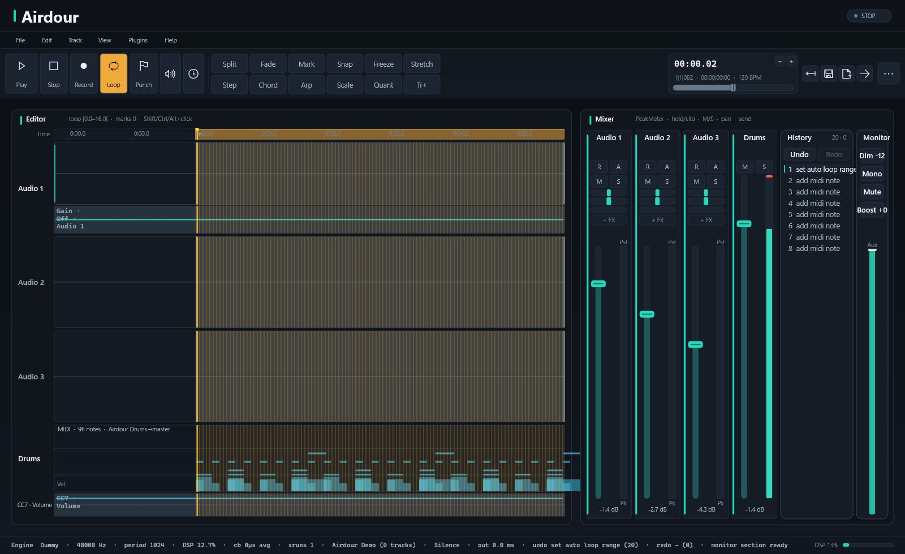

*Figure 1 — the complete workspace: brand bar and menu, transport, editor on the
left, mixer on the right, status bar along the bottom. (Captured with the Dummy
backend so the transport is stopped.)*

The window is divided into fixed regions, top to bottom:

1. **Brand bar** — the Airdour wordmark, plus a state pill on the right that reads
   `PLAY`, `REC` or `STOP`.
2. **Menu bar** — `File`, `Edit`, `Track`, `View`, `Plugins`, `Help`.
3. **Transport bar** — transport buttons, edit and MIDI action rows, the clock and
   tempo block, file actions and the overflow menu.
4. **Editor** (left, ~64% of the width) — ruler, audio lanes, one audio automation
   lane, the MIDI piano roll with its velocity lane, and the MIDI CC lane.
5. **Mixer** (right) — channel strips, the History panel and the Monitor section.
6. **Status bar** — engine state, sample rate, buffer period, DSP load, xruns, the
   session name and track count, monitor state, and the snap-density chip.

Airdour is per-monitor DPI aware: every dimension, font and hit target scales with
the monitor you move the window to.

---

## 4. Transport bar

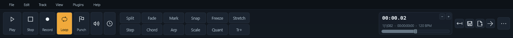

*Figure 2 — the transport bar: primary transport, edit actions, MIDI actions, clock,
tempo, file actions and the overflow button.*

### 4.1 Primary transport

| Button | Effect |
| --- | --- |
| **Play** (`Space`) | Start or stop playback. The pill in the brand bar shows `PLAY`. |
| **Stop** | Stop and leave the playhead where it stopped. |
| **Record** | Arm recording and roll. |
| **Loop** (`L`) | Toggle the loop range. Lit amber while loop playback is armed. |
| **Punch** (`P`) | Toggle the punch range used for punch-in recording. |
| **Click** | Toggle the metronome. |
| **Count-in** (`C`) | Play a count-in bar before recording starts. |

### 4.2 Edit row

`Split` (`S`), `Fade` (`F`), `Mark` (`M`), `Snap` (`G`, cycle density with
`Shift+G`), `Freeze` (`Z`) and `Stretch` (`T`) act on the current selection or the
focused track. Buttons show a latched state when their mode is active.

### 4.3 MIDI row

`Step` (`F4`) arms step recording, `Chord` (`F5`) cycles Off → Major → Minor, `Arp`
(`F6`) toggles the arpeggiator, `Scale` (`F7`) toggles scale lock, `Quant` (`Q`)
quantises the selected notes to the snap grid, and `Tr+`/`Tr−` transpose by a
semitone (`Shift` for an octave).

### 4.4 Clock, tempo and shuttle

The clock shows **bars|beats|ticks** on the first line and a **timecode** readout
below it, followed by the session tempo (`120 BPM`). The `−` and `+` buttons at the
right of the clock change tempo by 1 BPM (`-` / `+` on the keyboard).

The shuttle strip under the clock is dragged to scrub: dragging left of centre plays
backwards, right of centre forwards, with speed proportional to the distance from
the centre dead zone.

### 4.5 File actions

Four buttons to the right of the clock map to **Import Audio**, **Save Session**,
**Open Session** and **Export Mixdown**. The `…` button opens the overflow menu.

### 4.6 Overflow menu

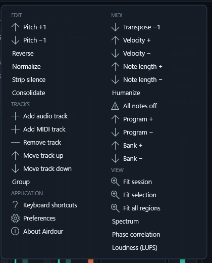

*Figure 3 — the transport overflow menu groups the actions that do not fit in the
bar.*

| Group | Commands |
| --- | --- |
| **EDIT** | Pitch +1 / −1 (RubberBand), Reverse, Normalize, Strip silence, Consolidate |
| **MIDI** | Transpose ±, Velocity ±, Note length ±, Humanize, All notes off, Program ±, Bank ± |
| **TRACKS** | Add audio track, Add MIDI track, Remove track, Move track up / down, Group |
| **APPLICATION** | Keyboard shortcuts, Preferences, About Airdour |
| **VIEW** | Fit session, Fit selection, Fit all regions, Spectrum, Phase correlation, Loudness (LUFS) |

---

## 5. Menus

Menus are drawn by the shell (no Win32 menu resources), so they follow the Airdour
theme and DPI scaling.

### 5.1 File

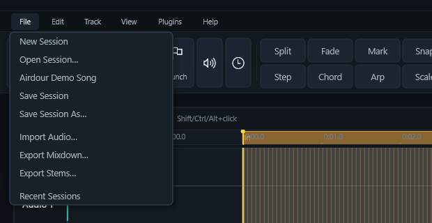

*Figure 4 — File menu.*

| Item | Shortcut | Notes |
| --- | --- | --- |
| New Session | `Ctrl+N` | Choose a parent folder and a session name. |
| Open Session… | `Ctrl+O` | Folder picker; a session is a folder, not a single file. |
| Airdour Demo Song | — | Reopens (or builds) the demo and binds its drum part. |
| Save Session | `Ctrl+S` | Writes the session XML, playlists and MIDI data. |
| Save Session As… | `Shift+Ctrl+S` | Saves a copy, including media. |
| Import Audio… | — | Adds an audio file to the focused/armed audio track. |
| Export Mixdown… | `Ctrl+E` | Renders the master bus to a 16-bit WAV. |
| Export Stems… | `Alt+Shift+E` | Renders one WAV per track. |
| Recent Sessions | `Ctrl+Shift+O` | Opens the recent-sessions drawer. |

### 5.2 Edit

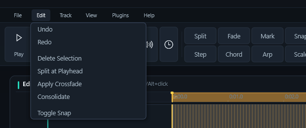

*Figure 5 — Edit menu.*

`Undo` (`Ctrl+Z`), `Redo` (`Ctrl+Y`), `Delete Selection` (`Del`), `Split at
Playhead` (`S`), `Apply Crossfade` (`F`), `Consolidate` (`B`) and `Toggle Snap`
(`G`). Undo history is transaction-based: every edit shows up as a named entry in
the History panel of the mixer.

### 5.3 Track

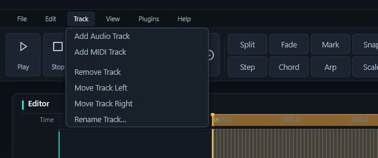

*Figure 6 — Track menu.*

`Add Audio Track`, `Add MIDI Track`, `Remove Track`, `Move Track Left`, `Move Track
Right` and `Rename Track…` (`F2` renames the focused track).

### 5.4 View

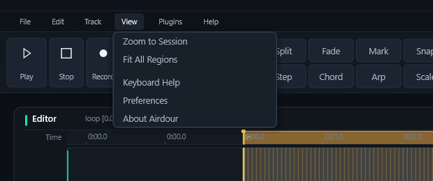

*Figure 7 — View menu.*

`Zoom to Session`, `Fit All Regions`, `Keyboard Help` (`F1`), `Preferences`
(`Ctrl+,`) and `About Airdour` (`F3`).

### 5.5 Plugins

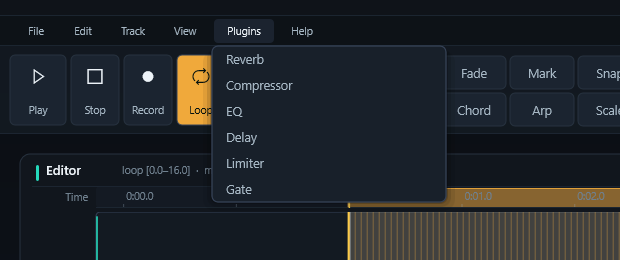

*Figure 8 — Plugins menu.*

Inserts one of the bundled ACE effects on the focused audio track: `Reverb`,
`Compressor`, `EQ`, `Delay`, `Limiter`, `Gate`.

### 5.6 About

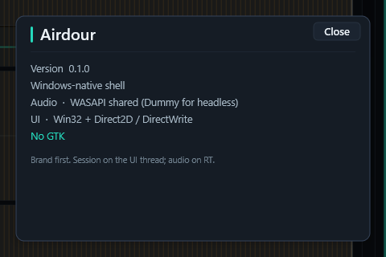

*Figure 9 — **View ▸ About Airdour** (`F3`) shows the build version, the audio and
UI stacks in use, and closes with **Close** or `Esc`.*

### 5.7 Help

The Help title has no dropdown; it opens the keyboard overlay directly (see
[section 15](#15-keyboard-shortcuts)).

---

## 6. The editor

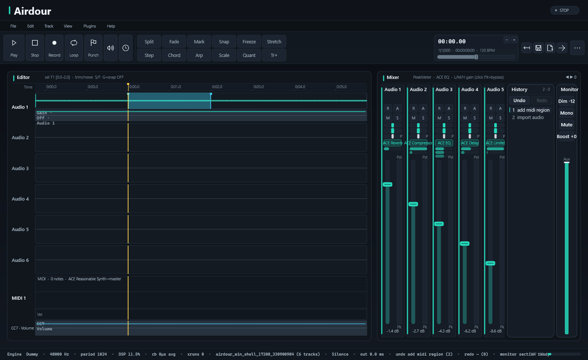

*Figure 10 — the editor after importing audio: waveform lanes on the left, the audio
automation lane under Audio 1, and the MIDI piano roll below the audio tracks.*

### 6.1 Layout

- **Ruler** along the top of the editor shows bars and beats, loop and punch ranges,
  and markers. Dragging on it scrubs the playhead continuously.
- **Audio lanes** stack vertically, one per audio track, with the track name on the
  left. Lanes scroll with the wheel when they don't all fit, and keep a minimum
  height so waveforms stay readable.
- **Automation lane** sits under the focused audio track and cycles
  Gain → Pan → Send with `Alt+Shift+A`.
- **Piano roll** shows the focused MIDI track's part between C3 and B4 by default;
  `PageUp`/`PageDown` move the pitch window by octaves.
- **MIDI CC lane** below the piano roll, cycling with `F8` through CC7 Volume,
  CC1 Mod, CC11 Expression, CC64 Sustain, Pitch Bend, Pressure and PolyAT.

### 6.2 Grid and snapping

`G` toggles snapping; `Shift+G` cycles the density (Bar → Beat → 1/2 → 1/4). The
current density is shown on the Snap button and in the status-bar chip, and ruler
ticks follow it.

### 6.3 Zoom and navigation

| Action | How |
| --- | --- |
| Zoom in / out | Mouse wheel, or `Ctrl+` `+` / `Ctrl+` `-` |
| Scroll the timeline | `Shift`+wheel, or `←` / `→` (`Shift` for a page) |
| Fit all regions | `A` |
| Fit the whole session | `Shift+A` |
| Fit the selection | `E` |
| Follow the transport | `Home` or `0` |
| Locate to selection start / end | `Shift+Home` / `Shift+End` |
| Locate session start / end | `Ctrl+Home` / `Ctrl+End` |

---

## 7. Audio regions

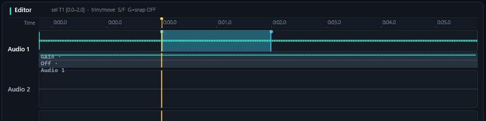

*Figure 11 — an imported region: waveform, selection tint, trim handles at both
edges, and the fade handles in the top corners.*

Click a region to select it. Selection tints the region, moves the automation lane
to that track and enables the region commands.

### 7.1 Editing gestures

| Gesture | Result |
| --- | --- |
| Drag the body | Move the region in time (and between lanes) |
| Drag the left / right edge | Trim the start / end non-destructively |
| Drag the top corners | Fade in / fade out |
| Click the ruler | Locate the playhead |
| `Tab` / `Shift+Tab` | Select the next / previous region |
| `Ctrl+←` / `Ctrl+→` | Nudge by the snap unit (`Shift` = 4×) |
| `Ctrl+D` | Duplicate the region after itself |

### 7.2 Region commands

| Command | Shortcut | Effect |
| --- | --- | --- |
| Split at playhead | `S` | Cuts the selected region at the playhead |
| Apply crossfade | `F` | Overlap fade between selected neighbours |
| Fade in / out | `Alt+[` / `Alt+]` | ±10 ms; `Shift` for the other side |
| Cycle fade shape | `Shift+F` | Linear, Power, Fast, Slow, Symmetric |
| Gain ±1 dB | `Ctrl+Shift+↑` / `↓` | Region gain |
| Normalize | `N` | Peak-normalises to −1 dBFS |
| Reverse | `V` | Reverses the audio in place |
| Strip silence | `I` | Splits at a −40 dBFS threshold |
| Consolidate | `B` | Bounces the selection (with track gain and plug-ins) |
| Stretch | `T` / `Shift+T` | RubberBand time-stretch 1.5× / 0.75× |
| Pitch ±1 semitone | `R` / `Shift+R` | Duration preserved |
| Duplicate | `Ctrl+D` | Copies the region after itself |
| Delete | `Del` | Removes the region from the timeline |
| Mute / unmute | `Ctrl+M` | Marks the region silent |
| Lock | `Ctrl+L` | Blocks move and trim |
| Opaque / transparent | `Alt+O` | Overlay behaviour for stacked regions |
| Rename | `Shift+F2` | Renames the region |
| Freeze track | `Z` | Renders the track and disables its real-time DSP |

### 7.3 Loop, punch and markers

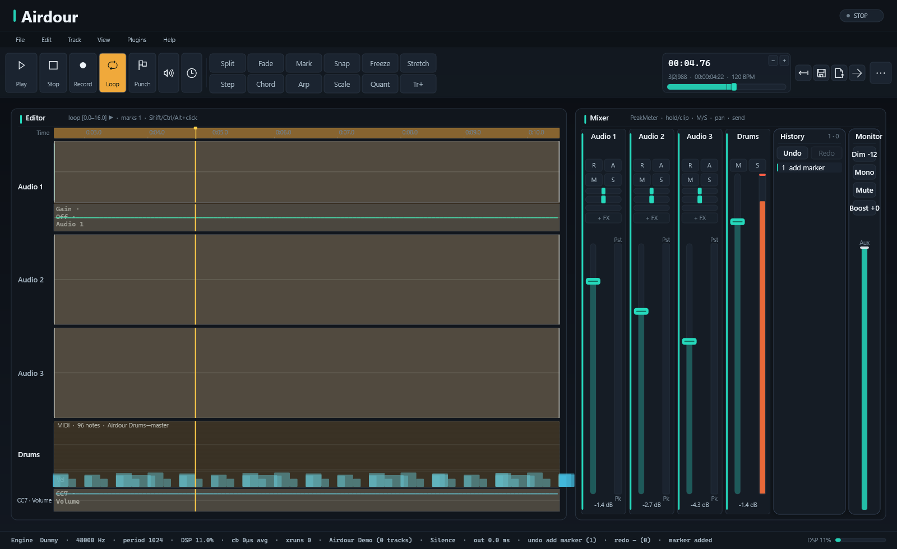

*Figure 12 — an 8-bar loop range (amber wash across the lanes) with a marker placed
at the playhead.*

- `L` toggles the loop range, `P` the punch range.
- `[` / `]` set the loop start / end at the playhead; `Shift+[` / `Shift+]` do the
  same for punch.
- `M` adds a marker at the playhead, `Shift+M` removes it.
- `Ctrl+Alt+←` / `→` jump to the previous / next marker.
- `Ctrl+Shift+M` locks a marker, `Ctrl+Alt+M` toggles its CD flag.
- Loop, punch and skip ranges can also be created from the current selection:
  `Ctrl+Shift+L`, `Ctrl+Shift+P`, `Ctrl+Shift+K`.

---

## 8. The piano roll and MIDI editing

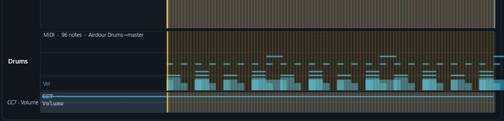

*Figure 13 — the piano roll: note grid on top, velocity lane below it, and the MIDI
CC lane at the bottom. The demo's drum part is bound, so the roll is scrolled to the
kit's pitch range.*

### 8.1 Drawing and editing notes

| Gesture | Result |
| --- | --- |
| Click / drag on empty grid | Create a note (drag to set length) |
| Click a note | Select it |
| `Shift`+click | Add to / remove from the selection |
| Drag a note body | Move in time and pitch |
| Drag a note's left / right edge | Trim start / end |
| Drag in the velocity lane | Set velocity for the note under the pointer |
| `Shift`+drag on empty space | Marquee box-select (`Ctrl` adds to the selection) |
| `Ctrl+C` / `Ctrl+X` / `Ctrl+V` | Copy / cut / paste notes at the playhead |
| `Del` | Delete the selected notes |

### 8.2 Transforms

| Command | Shortcut |
| --- | --- |
| Quantize to snap grid | `Q` |
| Legato (notes abut) | `Ctrl+Alt+Q` |
| Force note length to the snap unit | `Shift+Q` |
| Transpose ±1 semitone | `,` / `.` (`Shift` = ±12) |
| Velocity ±1 | `↑` / `↓` (`Shift` = ±8) |
| Force velocity 100 / 64 | `Ctrl+Alt+V` / `Alt+V−` |
| Note length ± snap unit | `Alt+←` / `Alt+→` |
| Humanize (timing + velocity) | `H`, `Shift+H` for 2× |
| Program change ± / bank ± | `P+` `P−` / `B+` `B−` |
| All notes off (panic) | `F9` |

### 8.3 Selecting by musical property

The piano roll can extend a selection by pitch, velocity, pitch class, length or
channel, and by range membership (inside/outside the loop and punch ranges), all
from the `Ctrl+Alt+Shift+…` family listed in the in-app shortcut overlay. `Ctrl+Shift+A`
selects every note and `Ctrl+Shift+I` inverts the selection.

---

## 9. Step entry, chords, arpeggiator and scale lock

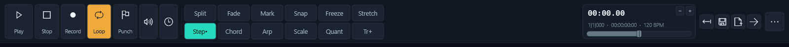

*Figure 14 — `F4` arms step recording; the Step button is lit and the status bar
confirms "MIDI step-record on".*

- **Step entry** (`F4`): the typing keyboard becomes a piano that follows the visible
  pitch window — `Z`–`M` and `Q`–`U`. `→` advances one grid step without writing a
  note, `←` steps back. Every placement is logged with its pitch and start time.
- **Chord mode** (`F5`): Off → Major → Minor. Held step keys latch into chords.
- **Arpeggiator** (`F6`): toggles on/off; `Shift+F6` cycles Up, Down and Up-Down.
- **Scale lock** (`F7`): constrains entered notes to a scale; `Shift+F7` cycles
  major/minor and `Ctrl+F7` sets the root.

All four modes report their state on the transport row and in the status bar.

---

## 10. Mixer

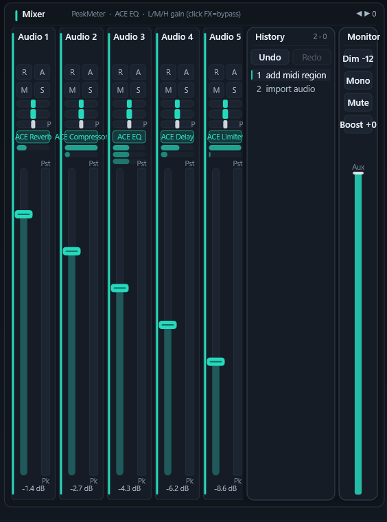

*Figure 15 — mixer strips with fader, pan, mute/solo/arm, sends, FX slot and peak
meter, next to the History panel and the Monitor section.*

### 10.1 Channel strip

| Control | Behaviour |
| --- | --- |
| **Label** | Click to focus the track (the automation lane follows); drag to reorder |
| **R / A** | Record-arm. `Alt`+click disarms all; `Alt+Shift`+click arms all |
| **M / S** | Mute / solo. `Shift`+click solo = solo-isolate; `Ctrl`+click = solo-safe; `Alt`+click = exclusive solo |
| **Pan knob** | Drag to pan; `Shift`+drag sets stereo width; double-click centres; `Alt`+click centres every track |
| **Send** | Drag for aux send level; `Shift`+drag pans the send; `Ctrl`+click mutes it |
| **Fader** | Drag for level; double-click returns to unity; `Alt`+click resets every fader |
| **Trim** | Pre-amp trim at the top of the strip |
| **FX slot** | Shows the inserted plug-in; click to bypass; `+ FX` opens the plug-in picker |
| **Meter** | Peak meter with hold/clip. `Alt`+click clears clip latches; `Shift`+click cycles the tap point; `Ctrl`+click switches Peak/K14 |

### 10.2 Inserts at a glance

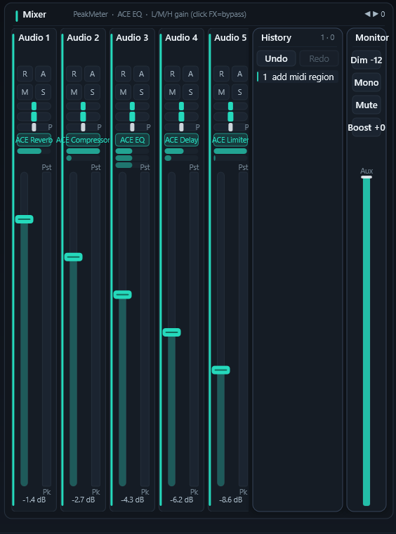

*Figure 16 — five audio strips, each showing its ACE insert (Reverb, Compressor, EQ,
Delay, Limiter) and the parameter controls that belong to it.*

Each bundled effect exposes its most important parameters directly on the strip, so
you can work without opening a plug-in window. Dragging a parameter bar changes the
value; double-clicking it restores the default.

### 10.3 History panel

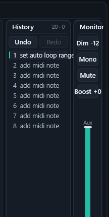

*Figure 17 — the History panel lists every undoable transaction; click an entry to
jump straight to that state.*

The panel shows the undo/redo counts, `Undo` and `Redo` buttons and the transaction
list. Clicking an entry jumps to that point in history (`Ctrl+Z` / `Ctrl+Y` do the
same one step at a time).

### 10.4 Monitor section

`Dim` (−20/−12/−6 dB), `Mono`, `Mute` and `Boost` (0/+3/+6 dB) apply to the monitor
path only, not to the exported mix. The `Aux` fader at the bottom sets the aux return.

### 10.5 Mixer navigation and grouping

- When there are more strips than fit, scroll with `Alt+Shift+←/→` or the wheel.
- `Alt+Shift+W` switches to narrow strips so more channels fit on screen.
- `U` applies a track group (mute, solo, gain, arm shared), `Shift+U` clears it.
- `Alt+↑` / `Alt+↓` reorder the focused audio track.
- `Alt+Shift+M` mutes all, `Alt+Shift+U` solos all, `Alt+M` / `Alt+U` clear all mutes
  and solos.

---

## 11. Plug-ins and effects

### 11.1 Bundled ACE effects (LV2)

Airdour ships a set of headless LV2 effects that work with no extra installation:

| Effect | Controls |
| --- | --- |
| **ACE Reverb** | Wet/dry Blend, bypass |
| **ACE Compressor** | Threshold, ratio, attack, release, sidechain |
| **ACE EQ** | Low / Mid / High gain |
| **ACE Delay** | Time, Feedback |
| **ACE Limiter** | Ceiling, release |
| **ACE Gate** | Threshold, hold |

`ACE Reasonable Synth` is the built-in instrument on the MIDI track, so MIDI parts
make sound with no external sound font or plug-in.

### 11.2 VST3 hosting

Airdour scans the standard VST3 locations (`C:\Program Files\Common Files\VST3`)
plus anything on `VST3_PATH`. The installed package points `VST3_PATH` at the
bundled `VST3\AirdourSynths.vst3`, so the demo instruments are found without
touching your plug-in folders.

- Insert: right-click a mixer strip and pick a scanned plug-in, or use
  **View ▸ Preferences** to browse the catalogue.
- Bypass and parameters: use the strip FX row or the status-bar chips
  (`BYP`, `RST`, `×`).
- Cycling through the catalogue on a strip: `Ctrl+Alt+Shift+,` / `.`.

> **Note:** **No plug-in editors.** VST3 and LV2 parameters are exposed as controls in the
> Airdour shell. A plug-in's own GUI window is not hosted in this build; hosting
> third-party editor windows needs a GTK/HWND host, which is out of scope for the
> Direct2D shell.

---

## 12. Analysis and metering

The three analysis panels appear under the editor lanes when enabled and read the
master bus. `Shift`+shortcut switches between track and master where applicable.

### 12.1 Spectrum analyser (`Y` / `Shift+Y`)

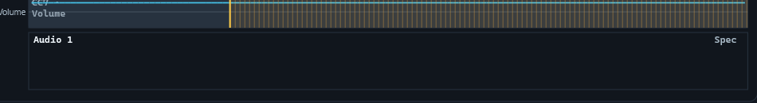

*Figure 18 — the spectrum panel labels the source it is analysing; with the transport
stopped and the Dummy backend there is no signal to draw.*

### 12.2 Phase correlation and goniometer (`X` / `Shift+X`)

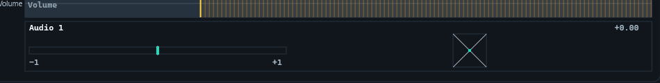

*Figure 19 — the correlation meter reads −1…+1 and the goniometer shows the stereo
field; useful for checking mono compatibility.*

### 12.3 Loudness (`J` / `Shift+J`)

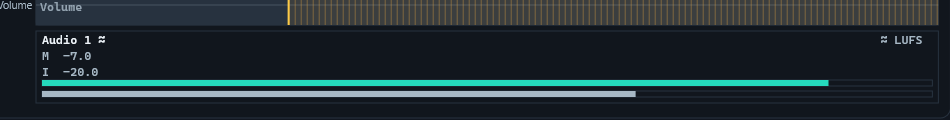

*Figure 20 — the LUFS panel shows an ITU-R BS.1770 K-weighted loudness reading for
the master mix.*

---

## 13. Sessions, import and export

### 13.1 What a session is

A session is a **folder**, not a single file. It holds the `.ardour` XML state, the
playlists and MIDI files, and the peak caches. Keep the folder together when you
copy or back it up.

### 13.2 Creating, opening and saving

- **File ▸ New Session** (`Ctrl+N`) asks for a parent folder and a name.
- **File ▸ Open Session…** (`Ctrl+O`) uses a folder picker.
- **File ▸ Save Session** (`Ctrl+S`) writes the session; the shell also autosaves a
  dirty session periodically.
- **File ▸ Save Session As…** writes a copy that includes the media.

### 13.3 Recent sessions

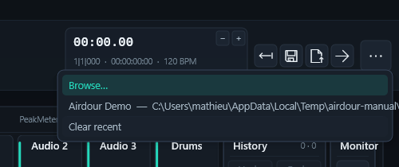

*Figure 21 — the recent-sessions drawer, opened with `Ctrl+Shift+O` or
**File ▸ Recent Sessions**.*

The drawer lists recent session folders, offers **Browse…** for a folder picker and
**Clear recent** to empty the list.

### 13.4 Importing audio

**File ▸ Import Audio…** or the transport import button adds an audio file to the
focused (or armed) audio track. Imported regions get peak caches and appear with
waveforms in the editor immediately; the import is a normal undoable transaction.

### 13.5 Exporting

| Export | Shortcut | Result |
| --- | --- | --- |
| Mixdown | `Ctrl+E` | Master bus → 16-bit PCM WAV |
| Stems | `Alt+Shift+E` | One WAV per track |
| Selection range | `Alt+E` | WAV of the selected time range |
| Selection region | — | Export the selected region to its own WAV |

Export runs through the headless `ExportHandler`; no plug-in GUI is involved, so the
render is sample-accurate and unaffected by window state.

---

## 14. Preferences

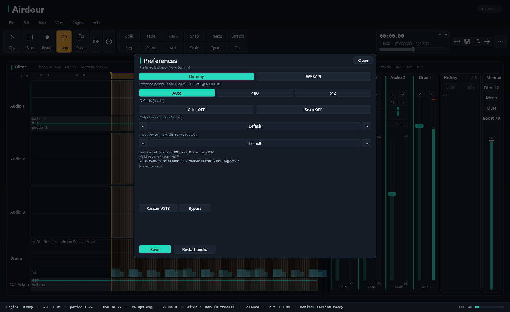

*Figure 22 — the Preferences overlay (**View ▸ Preferences** or `Ctrl+,`).*

| Section | What you can set |
| --- | --- |
| **Backend** | `Dummy` (silent, for testing) or `WASAPI` (shared-mode output), plus the buffer period: Auto, 480 or 512 frames |
| **Defaults** | Whether the metronome (click) and snapping start enabled in new sessions |
| **Audio devices** | Output and input device, with previous/next buttons, and **Restart audio** to re-open the device after a change |
| **VST3** | Rescan the plug-in folders, view the scanned catalogue, bypass or unload the current insert, reset its parameters |
| **Close / Save** | Close the panel, or persist the choices for the next launch |

Latency is reported per direction (input and output frames) so you can compare
buffer sizes in shared mode. Preferences persist to `instant.xml` plus the Ardour
RC configuration.

---

## 15. Keyboard shortcuts

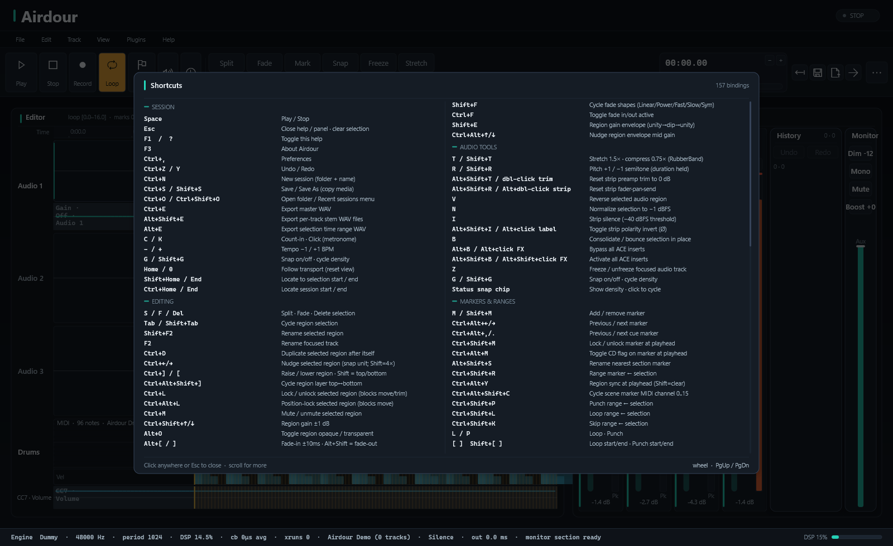

*Figure 23 — the in-app shortcut overlay (`F1`, `?` or **View ▸ Keyboard Help**)
lists every binding the shell actually handles.*

The overlay is scrollable and grouped by area: Session, Editing, Audio tools,
Markers & ranges, View & zoom, MIDI, Mixer and Mouse. The most-used bindings:

| Area | Keys |
| --- | --- |
| Transport | `Space` play/stop · `L` loop · `P` punch · `C` count-in · `K` click · `-`/`+` tempo |
| Files | `Ctrl+S` save · `Ctrl+O` open · `Ctrl+E` export · `Ctrl+Z`/`Ctrl+Y` undo/redo |
| Editor | `S` split · `F` fade · `Del` delete · `Ctrl+D` duplicate · `Tab` next region |
| Audio tools | `T` stretch · `R` pitch · `V` reverse · `N` normalize · `I` strip silence · `B` consolidate · `Z` freeze |
| MIDI | `Q` quantize · `,`/`.` transpose · `↑`/`↓` velocity · `H` humanize · `F4`–`F8` modes |
| Mixer | `U` group · `Alt+↑/↓` reorder · `Alt+Shift+M` mute all · `Alt+Shift+U` solo all |
| View | `A`/`Shift+A`/`E` fit · `G` snap · `Y`/`X`/`J` analysers |
| System | `Ctrl+,` preferences · `F1` help · `F3` about · `Esc` close overlay |

Also available in the overlay: region envelopes (`Shift+E`), fade shapes (`Shift+F`),
layer cycling, marker locking and CD flags, scene-marker channels, range markers,
selection-based zoom, and the full set of `Ctrl+Alt+Shift` MIDI selection filters.

---

## 16. Command line and smoke checks

`airdour_win_shell.exe` doubles as the verification harness used by CI. Run it
through `run-airdour.bat` so the DLL paths are set.

```text
Usage: airdour_win_shell.exe [OPTIONS]
```

### 16.1 General options

| Option | Meaning |
| --- | --- |
| `--backend [WASAPI\|Dummy]` | Choose the audio backend (WASAPI when available, else Dummy) |
| `--period N` | Override the buffer size in frames, e.g. `--period 256` |
| `--session <DIR>` | Open an existing session folder at startup |
| `--new-session <DIR>` | Create a named session at a full folder path |
| `--timeout N` | Exit automatically after N seconds with the smoke result as exit code |
| `--no-engine` | Run the UI alone, without starting the engine |
| `--no-splash` | Skip the startup splash |
| `--shot PATH` | Write one PNG of the current frame, then exit |
| `--shot-after MS` | Delay before that frame is taken (default 1200 ms) |

### 16.2 Smoke checks

Each `--smoke-<name>` flag exercises one subsystem and prints a pass/fail line. The
full set is whatever the shell dispatches, including:

`import`, `record`, `save-load`, `export`, `undo`, `loop`, `midi`, `midi-edit`,
`midi-quantize`, `midi-transpose`, `plugin`, `vst3`, `mute-solo`, `locate`, `zoom`,
`stretch`, `pitch`, `reverse`, `normalize`, `strip-silence`, `consolidate`,
`freeze`, `history`, `prefs`, `recent`, `recovery`, `spectrum`, `correlation`,
`loudness`, `demo`, `demo-proof`, `demo-menu`, `perf`, `ui-layout`, `track-capacity`.

```bat
:: device-free render of the demo, then a timing sample
run-airdour.bat --backend Dummy --smoke-demo --timeout 40
run-airdour.bat --backend WASAPI --smoke-perf --timeout 10
```

`--smoke-perf` samples WASAPI callback jitter, DSP percentage, xrun count and
working-set memory, and prints one `PERF` line per window.

### 16.3 Useful environment variables

| Variable | Effect |
| --- | --- |
| `AIRDOUR_WIN_SHELL_SESSION=0` | Skip the session; stub meters and empty lanes |
| `AIRDOUR_DLL_PATH` / `ARDOUR_BACKEND_PATH` | Where the engine DLLs and backends live (the launcher sets these) |
| `VST3_PATH` | Extra VST3 search roots |
| `ARDOUR_PANNER_PATH` | Extra panner search path |
| `AIRDOUR_WIN_SHELL_DEMO_TONES=1` | Create sine-test regions at session create (prefer Import) |

---

## 17. AI control over MCP

Airdour runs a Model Context Protocol server at `http://127.0.0.1:4820/mcp`, so an AI
assistant can drive the DAW over JSON-RPC without a plug-in or script host.

Supported method groups:

| Group | Methods |
| --- | --- |
| Transport | `transport/play`, `transport/stop`, `transport/locate`, `transport/loop_toggle`, `transport/set_record_enable` |
| Tracks | `tracks/list`, `tracks/add`, `buses/add`, `track/set_fader`, `track/set_pan`, `track/set_mute`, `track/set_solo` |
| Plug-ins | `plugin/list_available`, `plugin/add`, `plugin/remove`, `plugin/set_parameter`, `plugin/set_enabled` |
| Arrangement | `markers/add`, `region/move`, `region/split`, `region/set_gain`, `region/normalize` |
| MIDI | `midi_note/import_json`, `midi_note/get_json` |

```bash
curl -s http://127.0.0.1:4820/mcp \
  -H 'Content-Type: application/json' \
  -d '{"jsonrpc":"2.0","id":1,"method":"transport/play","params":{}}'
```

The server listens on loopback only.

---

## 18. Troubleshooting and known limits

| Symptom | What to check |
| --- | --- |
| `Failed to open audio device` | A remote/redirected session can expose zero render endpoints. Reconnect locally or start with `--backend Dummy`. |
| No sound, but meters move | Check the monitor `Mute`, `Dim` and `Mono` states and the master fader; the Dummy backend never reaches the speakers. |
| MIDI notes are silent | The track needs an instrument: `ACE Reasonable Synth` is added to the MIDI track automatically; VST3 instruments must be scanned and inserted. |
| A plug-in has no window | Expected: this build does not host plug-in editors (see section 11). |
| Launch fails with a missing DLL | Start through `run-airdour.bat` or the Start Menu shortcut. |
| The demo plays again on every launch | Delete `%LOCALAPPDATA%\Airdour\first-run-demo` only if you want to replay it; otherwise the demo is offered once. |

Known limits of the alpha:

- **Shared mode only** — no ASIO, no WASAPI exclusive mode, no DirectSound.
- **No plug-in editors** — parameters are surfaced in the shell.
- **MIDI depth** — note editing, quantise, transforms and CC lanes are implemented;
  per-note expression lanes beyond the CC automation lane are not.
- **Unsigned binaries** — SmartScreen warns on first run.
- **Release build recommended** — debug builds use far more memory (~410 MB working
  set vs ~116 MB) and much more DSP.

---

## 19. Where Airdour keeps its files

| Path | Contents |
| --- | --- |
| `<Documents>\Airdour\` | Created sessions, including `Airdour Demo` |
| `%LOCALAPPDATA%\Airdour\first-run-demo` | Marker that the demo was offered |
| `%APPDATA%\Ardour*\` | Ardour RC configuration and `instant.xml` preferences |
| `<install folder>\VST3\` | Bundled `AirdourSynths.vst3` instruments |
| `<install folder>\LV2\` | Bundled ACE effects and synth |
| `<session>\export\` | Rendered mixdowns and stems |

Session folders contain the `.ardour` XML state, playlists, MIDI files and peak
caches; copy the whole folder to move a project to another machine.

---

*Airdour is distributed under the GNU General Public License v2. It is based on
Ardour by Paul Davis and the Ardour community.*
